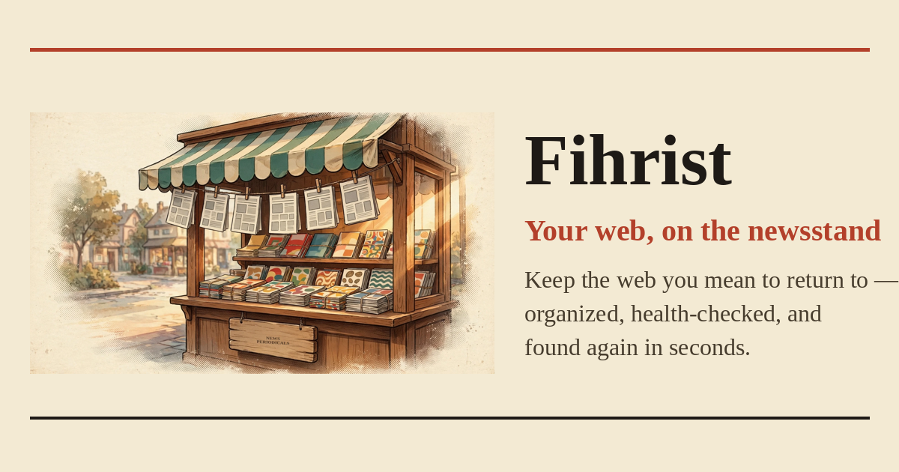

<p align="center">
  
</p>

<h1 align="center">Fihrist · فِهرست</h1>

<p align="center">
  <strong>A personal bookmark library for the web you want to return to.</strong><br />
  Arabic-first. Searchable. Built to notice when your links change.
</p>

<p align="center">
  <a href="https://fihristy.vercel.app/">Open Fihrist</a> ·
  <a href="#quick-start">Run locally</a> ·
  <a href="#how-to-use-fihrist">How to use it</a> ·
  <a href="#documentation">Documentation</a>
</p>

<p align="center">
  <strong>React 19 · TypeScript · Arabic / English · SQLite / Neon</strong>
</p>

---

## Your own corner of the web

Good links deserve more than a forgotten browser folder. Fihrist gives them a place on your shelf, makes them easier to find, and keeps a record of what happens to them.

- **Save** articles, references, tools, and other pages in one library.
- **Organize** with collections, tags, and personal notes.
- **Find** saved material with search and filters.
- **Check** whether a link still works, moved, or needs your attention.
- **Understand** changes through a per-link timeline and a readable link report.

<p align="center">
  
</p>

## What’s inside

| Feature | What you can do |
| --- | --- |
| **Bookmark library** | Save URLs, view extracted page metadata, add notes, and browse magazine-style covers. |
| **Collections & tags** | Group links by topic; use manual tags and automatic rule-based suggestions. |
| **Search & bulk actions** | Search your library, filter results, and organize or remove multiple bookmarks together. |
| **Browser import & export** | Import a browser bookmark HTML file or export in browser-compatible HTML. |
| **Link health** | Distinguish hard failures from redirects and inconclusive results. |
| **Check timeline** | See recorded checks, HTTP results, status changes, and how long a link has stayed broken. |
| **The Link Gazette** | Read a report of completed full-library runs: what broke, recovered, moved, or needs review. |
| **Optional AI** | Use your own compatible provider for bookmark insights, tag suggestions, and an optional Arabic report narrative. Approve or reject suggested tags. |
| **Chrome extension** | Save the current tab and search a running local library from the extension popup. |
| **Arabic & English** | Switch language, use right-to-left layouts, and choose light or dark mode. |
| **Installable app shell** | Install through a supporting browser. Offline caching covers static app files; private bookmark data and APIs are excluded. |

### A reading room with a newsstand soul

The visual identity takes its cue from **كشك الجرايد**, the neighborhood newsstand: warm paper, printed rules, illustrated shelves, editorial stamps, and a library preview hanging like a sheet of newsprint.

<table>
  <tr>
    <td align="center" width="33%"><br /><strong>Put links on a shelf</strong><br />Collections and tags</td>
    <td align="center" width="33%"><br /><strong>Keep track of changes</strong><br />Checks and timelines</td>
    <td align="center" width="33%"><br /><strong>Add a little assistance</strong><br />Optional AI suggestions</td>
  </tr>
</table>

These are the project’s illustration assets. For the palette, typography, component rules, and responsive layouts, see [DESIGN.md](DESIGN.md).

## How to use Fihrist

1. **Choose your library.** Open [Fihrist](https://fihristy.vercel.app/) and choose **Continue as Guest** for a browser-only library, or sign in for the configured cloud library. For the local server, open `/library` after starting it.
2. **Add your first link.** Choose **Add bookmark**, paste a URL, and save. The server-backed library retrieves page metadata. Health checks require a separate request.
3. **Make a shelf.** Create a collection, add tags, and leave a note explaining why you saved the page.
4. **Bring your old bookmarks.** Use **Import browser file** with a bookmark HTML export. Use **Export browser file** when you want a portable copy.
5. **Find something again.** Search the library or narrow it by collection, tag, or health status.
6. **Review link health.** In a server-backed library, request checks, open a bookmark’s history, and read the link report after a full run completes.
7. **Make it yours.** Switch AR/EN and light/dark mode. Configure AI only if you want the extra assistance.

### Choose the right mode

| Mode | Where bookmarks live | Best for |
| --- | --- | --- |
| **Guest** | IndexedDB in the current browser | Trying the library without an account. Guest bookmarks stay separate from account data and are not uploaded on sign-in. Server-side checks and AI are unavailable. |
| **Local server** | SQLite on your computer | A personal local library with server-side metadata processing, checks, and optional AI. No cloud account is required. |
| **Cloud** | Neon Postgres, with Neon Auth | A signed-in library on a configured deployment. Requires the cloud environment and database schema. |

> Guest storage belongs to that browser. Export important bookmarks before clearing site data or switching devices.

## Quick start

Use **Node.js 24** to match the Vercel runtime and **pnpm** to install dependencies.

1. Clone the project and install dependencies:

   ```bash
   git clone https://github.com/Hany-R-Mahmoud/fihrist.git
   cd fihrist
   pnpm install
   ```

2. Copy the optional environment template:

   ```bash
   cp .env.example .env
   ```

   The default local library does not need a Neon account or AI key. Leave cloud settings commented out for local use.

3. Start the local server:

   ```bash
   pnpm run dev
   ```

4. Open [localhost:3000/library](http://localhost:3000/library). The server binds to `127.0.0.1`; if port 3000 is occupied, use the address printed in the terminal.

SQLite storage is created automatically in the platform’s application-data directory under `Fihrist`. Set `FIHRIST_DATA_DIR` to choose another location. See [local database storage](server/_core/localDatabase.ts) for platform paths.

### Optional configuration

Set values in `.env` or the server environment, then restart the server.

| Variable | Purpose |
| --- | --- |
| `FIHRIST_DATA_DIR` | Override the local database directory. |
| `FIHRIST_AI_BASE_URL` | Base URL of an OpenAI-compatible AI provider. |
| `FIHRIST_AI_API_KEY` | Server-only provider key. Never commit it. |
| `FIHRIST_AI_MODEL` | Optional model selection; useful when a provider cannot list models. |
| `FIHRIST_EXTENSION_ORIGINS` | Comma-separated installed extension origins, such as `chrome-extension://YOUR_EXTENSION_ID`. |

- **AI setup:** follow [AI tagging](docs/ai-tagging.md) and [model selection](docs/ai-model-selection.md). Without a provider, rule-based tagging still works.
- **Extension setup:** follow the [installation guide](docs/extension-install.md). Load `extension/` unpacked, allow its origin, and point it at your local server.
- **Cloud setup:** use [.env.example](.env.example), the [cloud rollout guide](docs/neon/PRODUCTION_ROLLOUT_AND_OAUTH.md), and the schemas in `drizzle/postgres/`. Database credentials, AI keys, and `CRON_SECRET` stay server-side; Google OAuth uses app-hosted Better Auth with callback `https://fihristy.vercel.app/api/auth/callback/google`. Keep `GOOGLE_CLIENT_ID`, `GOOGLE_CLIENT_SECRET`, `BETTER_AUTH_URL`, and `BETTER_AUTH_SECRET` in the ignored `.env.local` and Vercel server environment. Existing email login stays on Neon Auth; both paths retain the same user IDs.

## How link health works

| State | Meaning |
| --- | --- |
| **Healthy** | The page is reachable. |
| **Redirected** | The address leads somewhere else. |
| **Broken** | A hard failure, such as DNS failure, connection refusal, or a consistent 404/410. |
| **Needs review** | An inconclusive result, including bot blocking or an ambiguous response. |
| **Unchecked** | No check has been recorded yet. |

A blocked request is not enough to call a page dead. Read the [health policy](docs/health-policy.md) for the classification rules.

Health checks run on request only. There is no automatic health schedule, including on import. Request a check from the health view or a link's timeline. Cloud mutations attempt up to two related jobs; use **Process a batch** to process up to four more queued jobs per click. Jobs are scoped to the signed-in user, and existing leases prevent duplicate claims. Waiting jobs remain waiting until requested; they do not indicate active work. The status banner separates waiting, processing, failed jobs, and broken or inconclusive health results. Status and AI suggestions no longer poll on a timer; use **Refresh results** for current results. Reports show recorded facts even when no AI key is configured or the optional narrative fails.

## For developers

### Commands

| Command | Purpose |
| --- | --- |
| `pnpm run dev` | Start the local development server. |
| `pnpm run check` | Run TypeScript checks. |
| `pnpm test` | Run Vitest tests. |
| `pnpm run check:runtime` | Check emitted serverless ESM handlers and authentication boundaries in Node. |
| `pnpm run build` | Build the web client and local Node server. |
| `pnpm start` | Start the built local server. |
| `pnpm run build:web` | Generate PWA icons and build the web client for Vercel. |

### Repository map

```text
client/             React interface, language messages, themes, and public artwork
server/             tRPC API, database adapters, authentication, and background work
api/                Vercel serverless handlers and guarded cron endpoint
drizzle/            SQLite and Neon schemas, plus SQL migrations
shared/             Shared types and plain-language health vocabulary
extension/          Unpacked Chrome extension: save a tab and search
docs/               Feature guides, cloud handovers, and portfolio facts
scripts/            Development launcher, icon generation, and runtime checks
DESIGN.md           Kiosk visual identity and interface rules
```

**Stack:** React 19 · TypeScript · Vite · Tailwind CSS · Radix UI · tRPC · Express · Drizzle ORM · SQLite / Neon Postgres · Neon Auth · Vitest.

## Status & current limits

- Chrome extension installation is manual; it is not published to the Chrome Web Store. Two-way sync with Chrome’s native bookmark tree is future scope.
- Offline support is an app shell, not an offline copy of the server-backed library.
- Guest mode does not run server-side scraping, health checks, or AI.
- Completed Google sign-in, real two-account cloud isolation, extension end-to-end behavior, and device PWA acceptance still need verification. Source implementation is not a claim that these flows have passed live acceptance.
- Git-triggered Vercel deployments are configured for `main` only. Manual and CLI deployments are separate.

## Documentation

| Guide | Read it for |
| --- | --- |
| [Design system](DESIGN.md) | Kiosk identity, tokens, and interface composition. |
| [Link health policy](docs/health-policy.md) | What each health verdict means. |
| [Chrome extension](docs/extension-install.md) | Installation, permissions, and save/search usage. |
| [AI tagging](docs/ai-tagging.md) | Provider configuration and suggestion approval. |
| [AI model selection](docs/ai-model-selection.md) | How the server selects an available model. |
| [Cloud rollout](docs/neon/PRODUCTION_ROLLOUT_AND_OAUTH.md) | Neon, OAuth, Vercel, and acceptance steps. |
| [Portfolio snapshot](docs/portfolio.json) | Structured, source-backed project facts. |

<p align="center">
  <a href="https://fihristy.vercel.app/">Open Fihrist</a> ·
  <a href="https://fihristy.vercel.app/privacy.html">Privacy</a> ·
  <a href="https://fihristy.vercel.app/terms.html">Terms</a>
</p>
